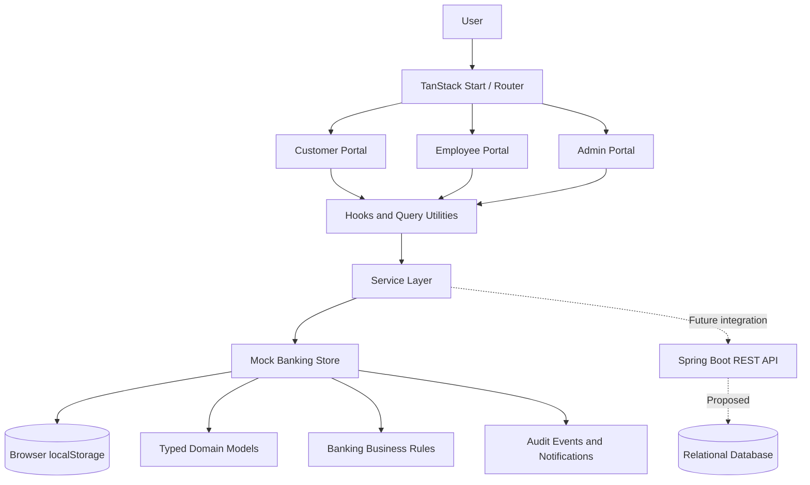

<div align="center">

# NEXUS BMS
### Enterprise Core Banking Management System

**A role-based banking operations platform designed around customer self-service, employee workflows, and centralized administration.**

<br/>


<br/>

**Customer Portal · Employee Portal · Admin Portal**

</div>

---

## Overview

NEXUS BMS is a core banking management **prototype** that brings customer banking journeys and internal bank operations into one role-oriented application. It models common banking workflows across three dedicated portals—Customer, Employee, and Administrator—using a shared set of domain entities, centralized business rules, and a service layer.

The project focuses on software engineering concepts that matter in enterprise applications: modular architecture, separation of concerns, typed domain modelling, reusable services, role-oriented workflows, transaction validation, ledger concepts, auditability, and automated testing of selected business rules.

> **Project status:** This repository currently runs with synthetic demo data, simulated authentication, and browser-persisted mock operations. It does not connect to a real bank, move real money, or provide production banking security. A Spring Boot backend and persistent relational database are future integration work—not part of the current implementation.

## At a Glance

| Area | Current implementation |
|---|---|
| Application model | Three role-based portals |
| Frontend | React 19 + TypeScript |
| Framework and routing | TanStack Start + TanStack Router |
| Data and async utilities | TanStack Query |
| UI and styling | Tailwind CSS 4, Radix UI / shadcn-style components |
| Forms and validation | React Hook Form + Zod |
| Charts | Recharts |
| State and persistence | In-memory mock store persisted in browser `localStorage` |
| Domain logic | EMI, amortization, loan eligibility, ledger balancing, rule-based transaction screening |
| Testing | Vitest + Testing Library |
| Backend integration | HTTP helper and endpoint map prepared; backend not included |

## Portals and Capabilities

### 1. Customer Portal

Provides a self-service banking experience using simulated customer and account records.

- **Dashboard:** account summary and banking activity.
- **Accounts:** view account details and balances.
- **Fund Transfers:** initiate simulated transfers with input validation and transaction feedback.
- **Transactions:** browse transaction history and inspect transaction details.
- **Beneficiaries:** manage saved transfer recipients.
- **Loans:** explore loan information, calculate EMI, assess prototype eligibility, and submit simulated applications.
- **Cards:** view card information and manage demo card controls.
- **Profile & KYC:** view profile and KYC-related information.

### 2. Employee Portal

Supports day-to-day service and operational workflows.

- Customer and account information.
- KYC application review.
- Transaction monitoring.
- Rule-based fraud alert investigation, severity and status tracking, and analyst notes.
- Loan application operations.
- Customer support tickets.
- Operational reports.

### 3. Administrator Portal

Provides centralized administrative and control-oriented screens.

- Administrative dashboard and KPIs.
- Employee management.
- Role and permission configuration.
- Branch management.
- General ledger views and reconciliation workflows.
- Audit log inspection.
- Compliance views.
- System settings and operational thresholds.

## Architecture

NEXUS BMS is organized into clear frontend and domain layers. Route pages compose the user experience; shared hooks and services provide access to application data; the mock store owns demo state transitions; and pure banking functions keep important calculations and rules separate from UI and storage.



**Architecture note:** the mock store and browser storage are the current data path. The Spring Boot API and relational database shown with dashed connections represent a proposed future architecture, not deployed components in this repository.

### Key engineering decisions

- **Role-oriented route groups:** Customer, Employee, and Admin workflows are separated into distinct route groups.
- **Typed domain model:** banking entities and status values are defined in TypeScript interfaces and union types.
- **Service abstraction:** application operations are kept behind service modules instead of scattering data access across pages.
- **Centralized domain rules:** reusable financial calculations and transaction-screening rules live in `src/lib/banking.ts`.
- **Reusable UI:** shared layout, data-table, finance, and UI components reduce duplication.
- **Testable business logic:** pure functions are tested independently of the browser UI and mock persistence.

## Banking Logic Demonstrated

The current prototype includes reusable domain functions for:

| Capability | Description |
|---|---|
| EMI calculation | Calculates an equated monthly instalment using principal, annual interest rate, and tenure. |
| Amortization | Generates a month-wise repayment schedule with principal, interest, and remaining balance. |
| Loan eligibility | Applies the prototype's credit-score and EMI-capacity rules. |
| Ledger balancing | Compares total debit and credit values for a set of ledger entries. |
| Transaction screening | Applies configurable large-transfer, transaction-velocity, and repeated-failure rules. |

### Simulated transfer lifecycle

A transfer in the demo follows a simplified workflow:

1. The customer submits transfer details.
2. The mock service validates the source account, amount, available balance, and configured transfer limit.
3. The transaction is screened using the configured rule-based checks.
4. The mock store updates the relevant demo state and creates transaction/ledger records.
5. A rule hit can result in an alert or an under-review workflow.
6. An audit event and user-facing result are recorded.

This is a demonstration of workflow and domain logic only. It is not an atomic, server-authoritative payment transaction.

## Technology Stack

| Category | Technologies |
|---|---|
| UI library | React 19 |
| Language | TypeScript |
| Full-stack application framework | TanStack Start |
| Routing | TanStack Router |
| Server-state utilities | TanStack Query |
| Styling | Tailwind CSS 4 |
| UI primitives | Radix UI and shadcn-style components |
| Forms | React Hook Form |
| Validation | Zod |
| Charts | Recharts |
| Icons | Lucide React |
| Build tooling | Vite |
| Testing | Vitest, Testing Library, jsdom |
| Code quality | ESLint, Prettier |

## Project Structure

```text
nexus-bms-main/
├── public/                     # Static public assets
├── src/
│   ├── components/
│   │   ├── data/                # Reusable data components
│   │   ├── finance/             # Banking and transaction UI
│   │   ├── layout/              # Application shell and navigation
│   │   └── ui/                  # Shared UI primitives
│   ├── hooks/                   # Reusable data and lookup hooks
│   ├── lib/
│   │   ├── auth.ts              # Simulated authentication and route access
│   │   ├── banking.ts           # Banking calculations and business rules
│   │   └── format.ts            # Formatting helpers
│   ├── mocks/
│   │   └── seed.ts              # Synthetic demo data
│   ├── routes/                  # File-based customer, employee and admin routes
│   ├── services/
│   │   ├── api.ts               # HTTP helper and planned endpoint map
│   │   └── store.ts             # Mock application store and operations
│   ├── test/                    # Unit and route tests
│   ├── types/
│   │   └── index.ts             # Shared domain models and types
│   ├── router.tsx
│   ├── server.ts
│   └── styles.css
├── package.json
├── bun.lock
├── vite.config.ts
└── tsconfig.json
```

## Getting Started

### Prerequisites

- Node.js compatible with the Vite version used by this project.
- npm or Bun.
- A modern web browser.

### 1. Clone the repository

```bash
git clone <your-repository-url>
cd nexus-bms-main
```

Replace `<your-repository-url>` with the URL of your Git repository.

### 2. Install dependencies

Using npm:

```bash
npm install
```

Or using Bun:

```bash
bun install
```

### 3. Start the development server

```bash
npm run dev
```

Or:

```bash
bun run dev
```

Open the local URL printed by the development server in your browser.

### 4. Available scripts

| Command | Description |
|---|---|
| `npm run dev` | Start the development server |
| `npm run build` | Create a production build |
| `npm run build:dev` | Create a development-mode build |
| `npm run preview` | Preview the production build |
| `npm run test` | Run the Vitest test suite once |
| `npm run test:watch` | Run tests in watch mode |
| `npm run lint` | Run ESLint |
| `npm run format` | Format files using Prettier |

## Demo Access

The current application includes hard-coded demo identities for its three roles. These credentials are intended only for local demonstration with synthetic data.

| Role | Demo email | Demo password |
|---|---|---|
| Customer | `aarav.mehta@mail.demo` | `Customer@123` |
| Employee | `kabir.malhotra@nexusbank.demo` | `Employee@123` |
| Administrator | `devika.raman@nexusbank.demo` | `Admin@123` |

**Security warning:** these are publicly visible demo credentials, not secure user accounts. Do not reuse them for any real service or deploy the current authentication implementation as production authentication.

## Configuration and Backend Integration

The API helper in `src/services/api.ts` defines the following environment configuration:

| Variable | Default | Purpose |
|---|---|---|
| `VITE_API_MODE` | `mock` | Selects the configured data mode; the current default is mock mode. |
| `VITE_API_BASE_URL` | `http://localhost:8080/api/v1` | Base URL intended for a future REST API. |

Example `.env.local`:

```env
VITE_API_MODE=mock
VITE_API_BASE_URL=http://localhost:8080/api/v1
```

The repository contains an HTTP helper and endpoint map for areas such as accounts, transactions, transfers, beneficiaries, loans, cards, KYC, fraud alerts, ledger, audit, employees, roles, branches, settings, and support tickets.

> Setting `VITE_API_MODE=http` or changing the API URL does not provide a working backend by itself. A compatible backend must be implemented and integrated before HTTP mode can be used end-to-end.

## Testing

The repository includes automated tests for selected business rules and routing behaviour.

The current banking-rule tests cover:

- Standard EMI calculation.
- Loan eligibility credit-score threshold.
- Ledger debit/credit balancing.
- Large-transfer severity rules.
- Transaction-velocity screening.
- Role-based portal path access.

A routing test checks that the root route resolves as expected.

Run the test suite:

```bash
npm run test
```

Test files are located in `src/test/`. Test coverage is not a claim that every page, workflow, security boundary, or integration has been tested. Run the commands in your environment and report the actual results.

## Security, Data and Prototype Limitations

NEXUS BMS is an educational and portfolio prototype. The following limitations are important:

- Authentication uses hard-coded demo users and a simulated token.
- Session and mock banking state are stored in browser `localStorage`.
- Portal access checks are client-side and are not a production authorization boundary.
- The supplied repository does not include a Spring Boot backend or relational database schema/migrations.
- Transfers and operational updates modify simulated browser-side data only.
- Financial calculations use JavaScript numeric values; production financial systems require decimal-safe monetary representation.
- There is no evidence in this repository of live payment-rail integration, production security certification, penetration testing, or regulatory approval.

Use synthetic data only. Never enter real banking credentials, account details, identity documents, or personal financial information.

## Roadmap

The following are proposed engineering extensions, not claims about the current codebase:

- Implement a Spring Boot REST API with server-side validation and authorization.
- Add MySQL persistence and schema migrations.
- Replace simulated login with a secure authentication solution and server-enforced RBAC.
- Implement atomic transfer posting, idempotency, concurrency control, and immutable double-entry ledger records.
- Expand automated testing with component, API integration, end-to-end, and security tests.
- Add structured logging, monitoring, backup, and operational recovery procedures.
- Integrate sandbox services for KYC and notifications where appropriate.

## Software Engineering Concepts

NEXUS BMS provides a practical context for exploring:

- Requirements engineering and SRS preparation.
- Role-based use-case modelling.
- Domain and data modelling.
- Modular and layered architecture.
- Separation of concerns and reusable components.
- Service abstraction and API design.
- Business-rule validation.
- UML modelling and system documentation.
- Unit testing and traceability.
- Security and data-integrity trade-offs.

## Documentation

The project documentation package can be maintained alongside this repository. Recommended contents:

- Software Requirements Specification (SRS).
- Use Case, Class, Sequence, Activity, Component, Deployment, State and ER diagrams.
- System Design Document.
- Data Dictionary and API Specification.
- Test Plan and Requirement Traceability Matrix.
- Security Assessment and Project Report.

Keep requirement IDs and diagram names consistent across the source code and documentation as the project evolves.

## Contributing

Contributions and improvements are welcome.

1. Fork the repository.
2. Create a feature branch.
3. Keep changes modular and typed.
4. Add or update tests for business-rule changes.
5. Run lint, tests, and build locally.
6. Submit a pull request describing the change and its impact.

## License

No license file was identified in the supplied repository. Add an appropriate `LICENSE` file before granting others permission to reuse, modify, or distribute this project.

---

<div align="center">

**NEXUS BMS — Core Banking Workflows, Modelled as a Software Engineering Project.**

*Built as an academic and portfolio prototype. All banking activity is simulated.*

</div>
